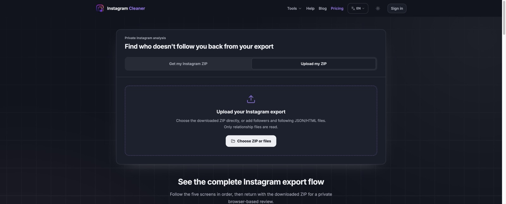

# Instagram Cleaner

Count followers, following, and the accounts that do not follow you back from an [Instagram data export](https://instagramcleaner.com/instagram-data-export-guide). The arithmetic runs on your computer. This repository does not ask for an Instagram password, and it does not upload the ZIP.

[](https://instagramcleaner.com)

[Instagram Cleaner](https://instagramcleaner.com) reads the same JSON files in the browser and turns the result into a list you can review. Accounts, reports, and the website source are not in this repository.

| List | What it is | Open it |
| --- | --- | --- |
| [Followers](https://instagramcleaner.com/blog/instagram-followers-export-explained) | Accounts that follow you in this export | [Where the followers file is](https://instagramcleaner.com/blog/instagram-followers-export-explained) |
| [Following](https://instagramcleaner.com/instagram-data-export-guide) | Accounts you follow in this export | [How to download the export](https://instagramcleaner.com/instagram-data-export-guide) |
| [Not following you back](https://instagramcleaner.com/blog/how-to-see-who-doesnt-follow-you-back-on-instagram) | In following, and not in followers | [See who does not follow you back](https://instagramcleaner.com/blog/how-to-see-who-doesnt-follow-you-back-on-instagram) |

Instagram Cleaner is an independent project and is not affiliated with, endorsed by, or sponsored by Instagram or Meta.

## Run the count

Requires Node.js 20 or newer. No install step.

```bash
node bin/instagram-export.mjs examples/sample-export
```

```text
Account: sample.account
Followers: 3
Following: 4
Mutual: 2
Not following you back: 2
You don't follow back: 1
```

Print one list:

```bash
node bin/instagram-export.mjs /path/to/your-export.zip --list not-following-back
```

`followers`, `following`, `mutual`, and `you-dont-follow-back` are the other list names. Pass an extracted folder if you already unzipped the download.

```bash
npm test
```

## The comparison

[](https://instagramcleaner.com/blog/how-to-see-who-doesnt-follow-you-back-on-instagram)

The two lists are sets of usernames. The sample export contains:

```text
followers: ada, grace, linus
following: barbara, grace, ken, linus
```

```text
mutual                 = followers ∩ following        = grace, linus
not following you back = following − followers        = barbara, ken
you don't follow back  = followers − following        = ada
```

`grace` is written twice, in `followers_1.json` at timestamp `1700001000` and in `followers_2.json` at `1700005000`. The handle is counted once, and the earlier timestamp is the one that is kept. Numbered followers files are parts of one list. Reading only `followers_1.json` makes everyone in the later files look like they do not follow you.

One export is the state of those two lists when Instagram built the file. It does not record who unfollowed you.

## The JSON files

[](https://instagramcleaner.com/instagram-data-export-guide)

Request **Followers and following** as **JSON**. The files this script reads are:

```text
followers_1.json
followers_2.json
following.json
```

`followers.json` without a number is read too. Photos, messages, and HTML files are ignored. A `personal_information.json` file is optional; when it includes a username, that handle is printed as `Account`.

A followers entry looks like this:

```json
{
  "title": "",
  "media_list_data": [],
  "string_list_data": [
    {
      "href": "https://www.instagram.com/grace",
      "value": "grace",
      "timestamp": 1700001000
    }
  ]
}
```

`following.json` wraps those entries in `relationships_following`. The username is `string_list_data[].value`. When that field is a display name, the handle is taken from the Instagram link, including links that use `/_u/`. Handles are compared in lowercase, and `@` is ignored.

The full request path, from Accounts Center through the ZIP, is in the [Instagram data export guide](https://instagramcleaner.com/instagram-data-export-guide).

## What stays out of this repository

This script prints counts, and with `--list` it prints usernames, on the machine where you run it. Do not paste a real export into an issue or pull request. The list is your social graph.

The website's ZIP check is a separate product. It reads the original file in the browser. This repository is only the file format and the set comparison.

## 中文说明

[Instagram Cleaner](https://instagramcleaner.com) 用你自己从 Instagram 下载的数据，比较粉丝列表和关注列表。本仓库在你的电脑上完成同一种计数：不索取 Instagram 密码，也不上传 ZIP。上面的图是网站的 ZIP 上传页、导出指南，以及「谁没有回关」的说明。

- [数据导出指南](https://instagramcleaner.com/instagram-data-export-guide)：在 Accounts Center 里只请求 Followers and following，格式选 JSON。
- [粉丝文件在哪里](https://instagramcleaner.com/blog/instagram-followers-export-explained)：`followers_1.json`、`followers_2.json` 是同一份粉丝列表，要一起读。
- [谁没有回关](https://instagramcleaner.com/blog/how-to-see-who-doesnt-follow-you-back-on-instagram)：关注列表减去粉丝列表。

示例里的粉丝是 ada、grace、linus，关注是 barbara、grace、ken、linus。互关是 grace 和 linus，没有回关的是 barbara 和 ken，你没有回关的是 ada。grace 出现了两次，只保留更早的时间戳。

一次导出只描述 Instagram 生成文件时的两份名单，不能从中看出谁曾经取关。账号、报告和网站源码不在这个仓库里。

## License

[MIT](LICENSE)
